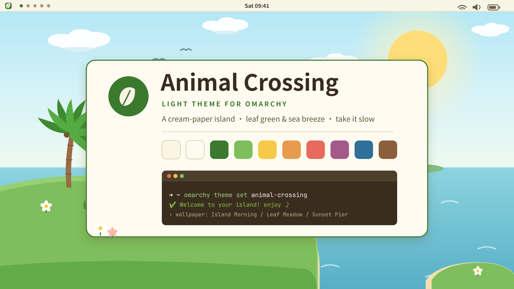
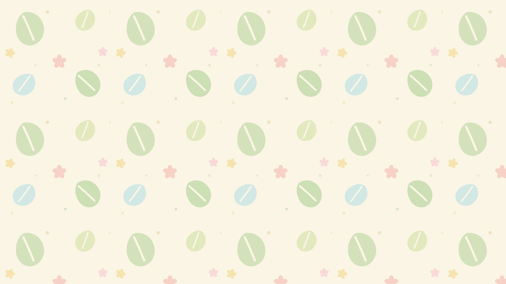

# 🍃 动物森友会 · Animal Crossing for Omarchy

一个 **Omarchy** 浅色主题：奶油纸色的底、叶子绿的重点、海风蓝的点缀，还有三张原创的手绘风壁纸。慢一点也没关系。

🌙 **夜间模式**：[omarchy-animal-crossing-night-theme](https://github.com/junbaor/omarchy-animal-crossing-night-theme) — 星夜姊妹主题。

语言 / Language: [English](README.md) · **简体中文**



## 壁纸

| 岛屿的早晨 | 落叶草原 | 黄昏栈桥 |
|:---:|:---:|:---:|
|  |  |  |

切换壁纸：`omarchy theme bg next`

## 安装

```bash
omarchy theme install https://github.com/junbaor/omarchy-animal-crossing-theme
omarchy theme set animal-crossing
```

安装后的主题名是 `animal-crossing`（Omarchy 主题名取自目录名，均为英文）。

## 配色

| 角色 | 色值 | 说明 |
|---|---|---|
| 背景 | `#FBF5E6` | 奶油纸色 |
| 强调 | `#3B7A2E` | 叶子绿（Nook Leaves 🍃） |
| 前景 | `#4A3B2B` | 暖棕 |
| 蓝 | `#2F6F99` | 海风蓝 |
| 黄 | `#9C6F0A` | 铃钱金（🔔） |
| 红 | `#C34F4B` | 气球珊瑚红 |
| 紫 | `#A35A89` | 花瓣紫 |
| 棕 | `#8B5E3C` | 木材棕 |

完整配色见 [colors.toml](colors.toml)。所有前景色都按 WCAG 对比度（≥ 4.5:1）校准，浅色底上也清晰可读。

## 自定义

1. 编辑 `~/.config/omarchy/themes/animal-crossing/colors.toml`
2. 运行 `omarchy theme refresh`

终端、Neovim、btop、VS Code、GTK、fcitx5、菜单/通知/锁屏等配置都会从 `colors.toml` 自动生成，不用手动改。

## 开机画面

让 Plymouth 开机画面也统一风格：菜单 → 样式 → Unlock，或

```bash
sudo omarchy-plymouth-set-by-theme animal-crossing
```

## 文件结构

```
├── colors.toml        # 核心配色（其余配置由 Omarchy 模板生成）
├── backgrounds/       # 三张 2560×1440 原创壁纸
├── sources/           # 壁纸的 SVG 源文件，欢迎改色再创作
├── preview.png        # 主题选择器预览图
├── icons.theme        # 图标包（Yaru-olive）
├── keyboard.rgb       # 键盘背光颜色
├── unlock.png         # Plymouth 开机画面 logo（叶绿）
└── preview-unlock.png # 开机画面预览
```

## 相关链接

- 🌙 夜间版：[omarchy-animal-crossing-night-theme](https://github.com/junbaor/omarchy-animal-crossing-night-theme)
- [Omarchy](https://omarchy.org/)

壁纸为原创矢量插画（SVG 源码在 `sources/`），可自由修改使用。

## License

[MIT](LICENSE)
